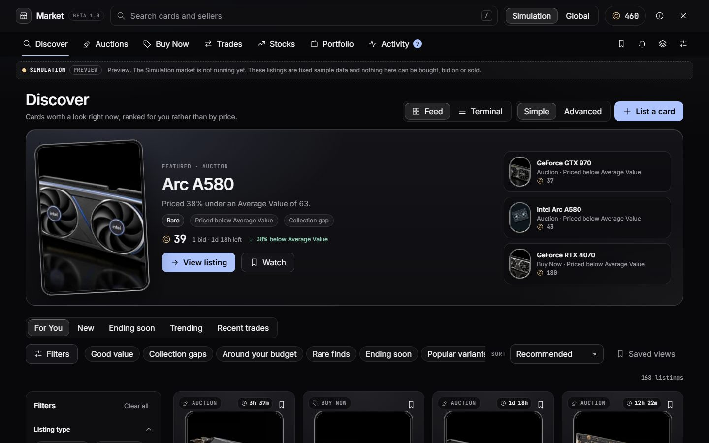
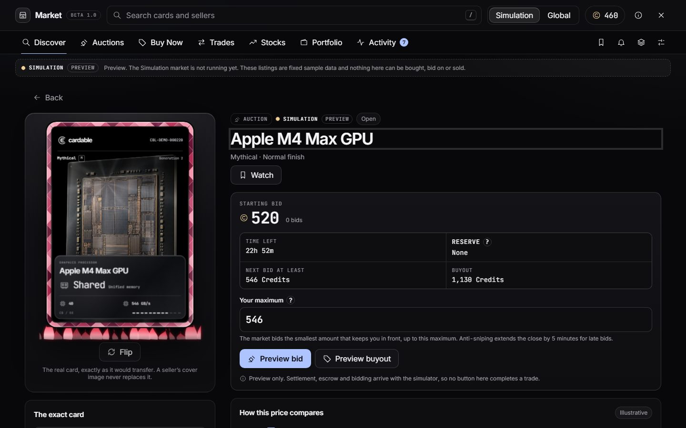
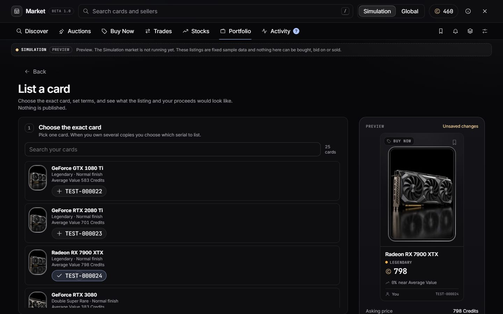
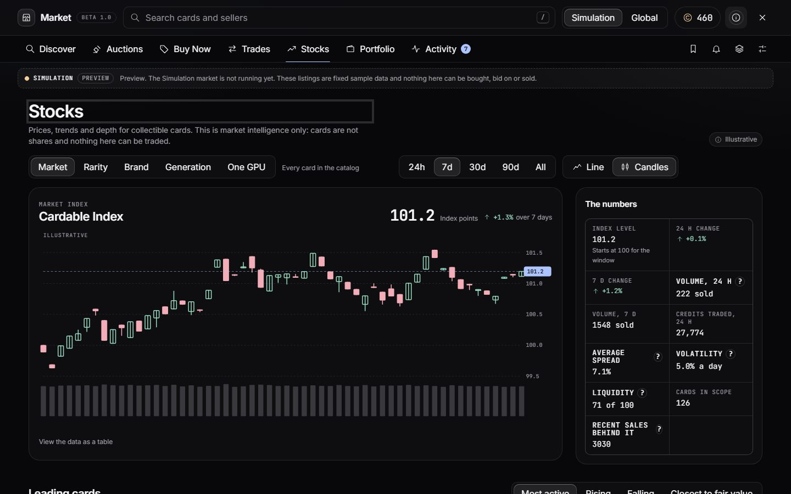
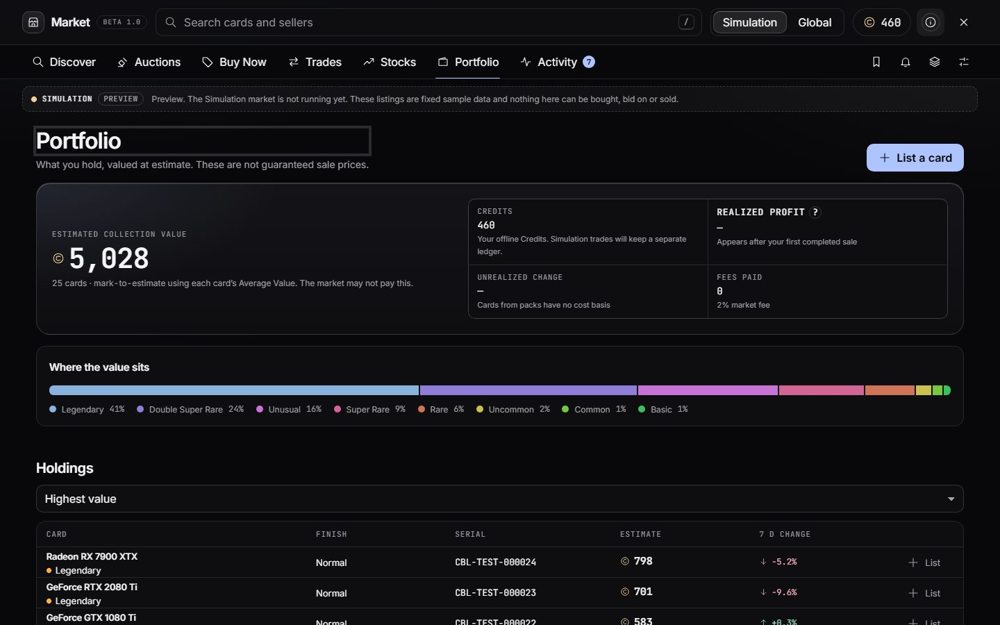
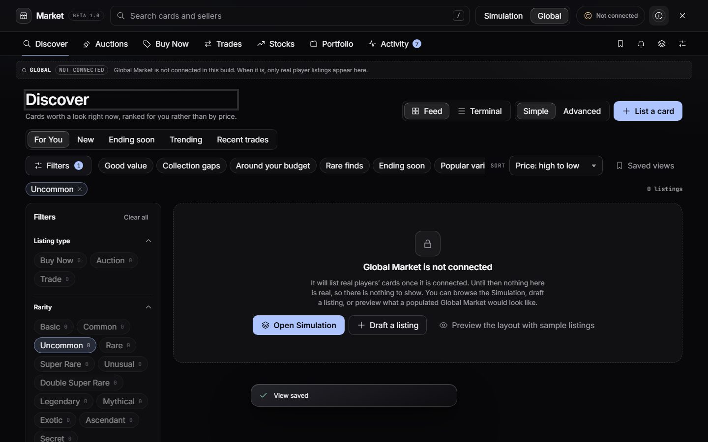
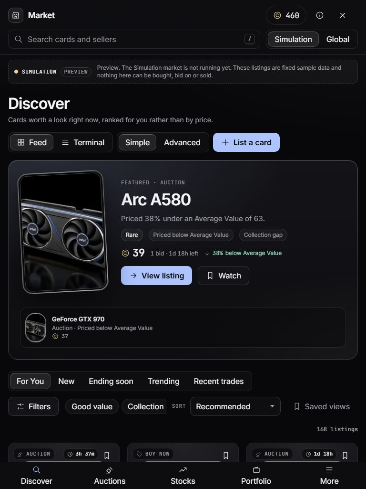
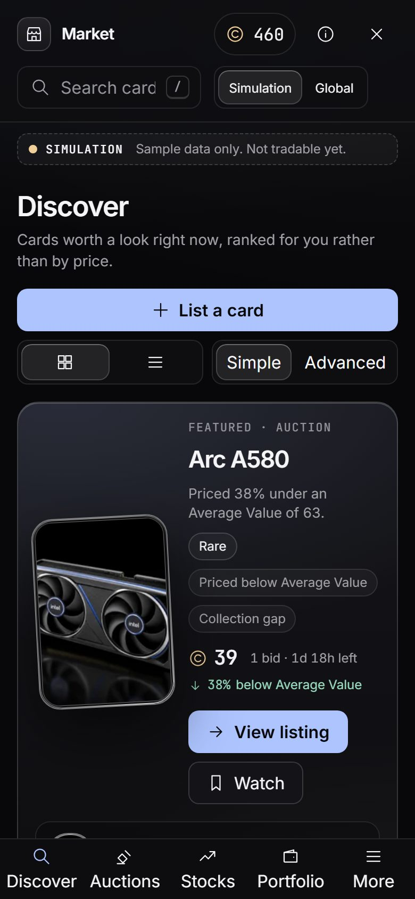
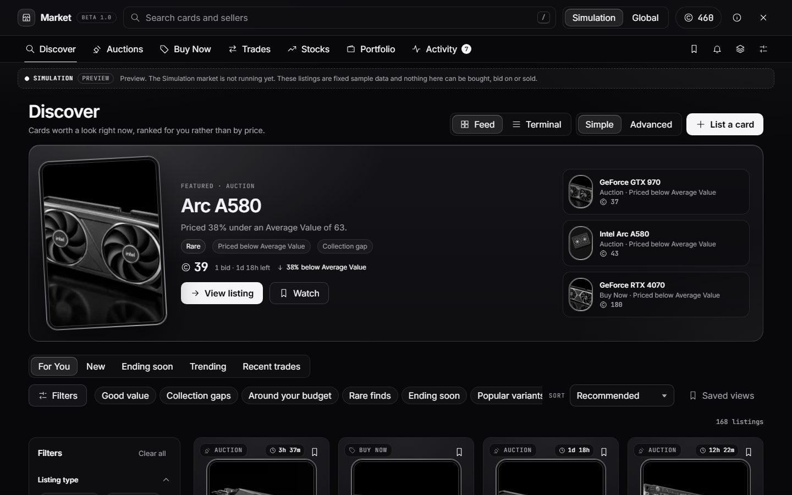

# Cardable Market Beta 1.0.0 — Stage 1 acceptance report

**Stage 1 of 8: the Market shell.** A polished, connected interface for Discover, Auctions, Buy Now, Trades, Stocks, Portfolio and Activity, with search, a realm selector, listing detail, card market, a listing composer, watchlist, alerts, My listings and Market settings, all running on deterministic, plainly labelled sample data behind a declared integration interface.

Branch `feature/market-beta` in the isolated worktree `D:/CardableV2/Market`, commit `stage 1: market UI`. Nothing here is released, merged to main, delivered, or deployed; no network is used and no Cloudflare resource was touched.

## 1. Source and isolation audit

| Item | Finding |
|---|---|
| Primary checkout | `D:/CardableV2/cardable-spec/cardable`, branch `main` at `b0aad12` ("stage 117: rare cloudbreak and save recovery"). Public mirror `https://github.com/resetrevxz/cardable` (origin). |
| Primary working tree | **Dirty** with unrelated v1.6.4 work in progress (14 modified files, untracked `src/fx/super-rare-glass.js`, `super-rare-intro.js`, `changelog/1.6.4.md`, `alpha-updates/website-rework/`). Not touched, not copied, not staged. |
| Worktrees registered before | `archive/worktrees/integration-1.4.3-baseline` (detached 64e9dd7), `MiniModeRework` (codex/mini-mode-1.4.1), `OptimizationPass3` (codex/optimization-pass3). No collision with `D:/CardableV2/Market` or `feature/market-beta`. |
| New worktree | `git worktree add D:/CardableV2/Market -b feature/market-beta main`. Based on **committed** `main`, so it does not contain the primary's uncommitted v1.6.4 work. Stage 8 must merge against a moved `main` (expect textual conflicts in `index.html`, `src/config.js`, `Designs.MD`, `docs/ROADMAP.md` and `package.json`). |
| Outer `D:/CardableV2` | An empty git repo (`master`, no commits) acting as the workspace container; unrelated. |
| Spec | `market.md` copied to the worktree root, unmodified. |
| Docs read | `AGENTS.md`, `Designs.MD` and `docs/ARCHITECTURE.md` in full; `docs/ROADMAP.md`, `docs/11-SETTINGS.md`, `03-CARD.md`, `VARIANTS-AND-TAGS.md` for their rules; `06-INVENTORY.md` by its consumers (`core/collection.js`, `core/inventory-model.js`) rather than line by line. |
| Instruction precedence | The owner's Market brief supersedes the older "no market" rule in AGENTS.md (edited on this branch) and the interim-release workflow. Every unrelated rule is preserved: classic scripts, `file://`, `window.Cardable`, schema 5 untouched, no save writes, audio and cloud saves off, `marketValueUsd` never read. |

### Screen system, reuse and load order

- **No screen registry exists in code.** `docs/ARCHITECTURE.md` mentions `C.screens` and `#market-slot`, but nothing implements them; full-window destinations in this codebase are overlays (`C.patchNotes`, Settings, the inventory sheet). The Market follows the Patch notes pattern: an overlay mounted in `C.viewport.parent(body)`, inert layers beneath, `C.accessibility.trap`, `menu:visibilityHold`, `qol:context`.
- **Reused:** `C.ui.present` (modal, focus trap and restore), `C.ui.toast`, `C.help.show`, `C.icons.register`, `C.cardView.create` (static `thumbnail` and one focused `full` card), `C.cardSpecs`, `C.finishes.describe` (Secret concealment), `C.commands`, `C.keys.register`/`listen`, `C.detailActions.register` (card detail More menu), `C.settings` schema and the Settings pages, `C.studioAlbum.list/get` (read-only), the HUD glass recipe, kit tokens, Inter and JetBrains Mono.
- **Load order** (`index.html`): `src/data/market-config.js` and `market-settings.js` load after the settings schema and before `settings-layout.js`; `src/market/{core,fixtures,store,api}.js` then `src/ui/market/{dom,parts,chart,shell,page-*,gallery}.js` load after `src/ui/patchnotes.js` and before `src/studio/entry.js`. `market.css` loads last. Everything initialises on `app:ready`.
- **Touched shared files (small, all additive):** `index.html` (links and scripts), `src/config.js` (`flags.market = true`), `src/core/keys.js` and `src/core/qol.js` (the Market counts as a dialog context), `src/data/settings-layout.js` (a Market page), `src/ui/kit/gallery.js` (one call), and docs.

## 2. What was built

About 6,000 new lines in classic scripts, in these layers:

| Layer | Files | Role |
|---|---|---|
| Data | `src/data/market-config.js`, `market-settings.js` | Every factor, fee, duration, threshold, label and glossary entry; thirteen `market*` settings in the shared schema. |
| Pure core | `src/market/core.js` | Fees, baseline values, ranking, search language, filters, facets, relax suggestions, sorting, pagination, series, draft validation. No DOM, no storage. |
| Sample data | `src/market/fixtures.js` | Deterministic listings, bots with personas, trades, bids, notices, a sample inventory. All `CBL-DEMO-######` serials. |
| Store | `src/market/store.js` | Session state and a small preview record in its own storage key. Never the save. |
| Interface | `src/market/api.js` | The provider contract: reads resolve, writes reject with `preview-only`. |
| UI | `src/ui/market/*.js`, `src/ui/kit/components/market.css` | Shell and router, pages, one chart, composer, gallery section. |
| Checks | `tests/market-core.test.cjs`, `tools/check-market-browser.cjs` | 22 pure tests; a headless browser acceptance run. |

### The areas

- **Discover**: editorial hero (confident discounts, scarcer cards first), tabs For You, New, Ending soon, Trending and Recent trades, presets, saved views, feed or terminal layout, cursor pagination, Simple and Advanced filters.
- **Auctions, Buy Now, Trades**: the same engine locked to a type, with auction state and, for trades, wanted-card and top-up language.
- **Listing detail**: the real card (one focused full card), price and action, value meter against bid, targets and Average Value, an explanation of why it ranks, seller trust, history, inactive comments, similar listings, and review dialogs.
- **Card market**: numbers, a chart with windows, open listings, recent trades, alerts, and a route into the composer.
- **Composer**: exact card by serial, three types, suggested prices, fee and net, title, note, local cover with aspect presets, Director album chooser, draft autosave, review.
- **Stocks**: scope (market, rarity, brand, generation, one GPU), five windows, line or candles, volume, the full metric set, four leader tables. Marked Illustrative.
- **Portfolio, Activity, Watchlist, Alerts, My listings, Market settings.**
- **Entries**: a HUD button, the `M` key, the command palette, and "List on Market…" in the card detail More menu.

## 3. Design decisions

1. **Honesty is structure, not a banner.** Realm badge and state in the header, notice row, detail pages and review dialogs. Global Market is *empty* while unconnected; sample listings need an explicit switch and are always labelled. Sample trades never count as volume.
2. **An overlay, not a screen in the menu.** The pack remains the main screen. The Market is entered from the HUD, the keyboard, the palette or a card.
3. **Recommended is a fit, not a price order.** Value against a confident Average Value, a *bell* around a comfortable share of the balance, collection gap, wishlist, liquidity, freshness, seller track record and resale margin, with every reason stated. Cheapest and priciest exist as plain sorts. A unit test asserts it is not price order.
4. **Fees and rounding are data.** 2% rounded half up with a one Credit minimum, so splitting a sale cannot dodge the fee. Targets use floor and ceil so cheap cards still show a spread.
5. **Previews never succeed.** Every action that would trade opens a review with exact terms and the sentence that nothing changed; the only primary action is Close preview. Writes in `api.js` reject with `preview-only`. Credits and inventory are asserted unchanged in the browser check.
6. **One listings engine.** Discover and the three type pages share filters, facets, chips, sorting, recovery and saved views, so behaviour cannot drift.
7. **Layout follows the Market's own width.** Container queries, not window queries, so the same layout works in a 390 px browser and in Electron's composed 1920 × 1080 layer.
8. **Cost discipline.** No chart per tile, no per-tile clock, thumbnails created within a screen of the viewport and released beyond it, one chart per page, no scheduler subscriber added by the Market.
9. **Secrets stay concealed.** An unfound Secret appears and is searched only as "Unfound Secret", in tiles, search, selects and fixtures.
10. **Settings are real or absent.** Each of the thirteen keys changes something that exists; Advanced-only ones are hidden in Simple.
11. **Preview records live apart from the save.** Watchlist, saved views, alerts and drafts use `cardable.market.preview`, never `cardable.save`, so no schema change and nothing to migrate or wipe. Clearing them is one click-again button.

## 4. Data contract

Shapes the UI relies on and later providers must satisfy (see `src/market/core.js` header):

```
Listing   { id, realm, format 'buy-now'|'auction'|'swap', status, ask, title, description,
            card { cardId, variantId, cardSkinId, serial, count, packId },
            seller { alias, isBot, persona?, sales, rating, tenureDays },
            valuation, listedMin, endsMin?, watchers, source,
            auction? { start, current, bids, reserve, reserveMet, increment, buyout, leaderAlias },
            swap?    { wanted[{cardId|rarity, minValuePct, label}], topUp, direction, openToCounter } }
Valuation { average, lastSale, confidence 'high'|'medium'|'low'|'none', samples, basis 'sales'|'baseline',
            targetBuy, targetSell, bestBid, lowestAsk, spread, volume24h, volume7d,
            change24h, change7d, volatility, liquidity, windowHours }
Filters   { q, formats, rarities, variants, generations, brands, packs, auctionStatus, valueRatio, price,
            fairValue, serial, ownership, withinBudget, listedWithin, minConfidence, minSellerRating, ... }
```

`C.market.api` reads (`status`, `wallet`, `listings`, `listing`, `cardMarket`, `trades`, `stocks`, `portfolio`, `activity`, `inventory`, `suggest`) return promises with a synchronous twin; writes (`purchase`, `placeBid`, `publishListing`, `cancelListing`, `makeOffer`, `respondToOffer`, `quickSell`) are declared and unavailable. `registerProvider(realm, provider)` verifies that a provider implements every method.

## 5. What is real and what is sample

| Real in Stage 1 | Sample only |
|---|---|
| Search, filters, facets and counts, chips, presets, sorting, pagination and no-results recovery over the sample set | Every listing, price, bid, trade, seller, notice and chart point |
| Watchlist, saved views, price alerts (checked against sample listings), drafts, recent searches | Average Value, targets, bid and ask, volume, confidence |
| The player's own cards, serials and wishlists, read-only (Portfolio, composer, Collection gap, ownership filter) | "My" listings, bids and activity |
| Fee and net proceeds, increments, validation and disabled reasons, Simple/Advanced rules | Purchase, bid, swap, offer, publish, cancel (reviews only) |
| Thirteen saved Market settings, used live | Realized and unrealized profit (no completed trades exist) |

## 6. Verification

Run: `npm run test:market` and `npm run check:market` (headless Chromium from disk; screenshots and `evidence.json` go to the ignored `qa-output/market-beta/`; a curated copy is committed under `docs/market-beta/`).

| Check | Result |
|---|---|
| `tests/market-core.test.cjs` | 22 of 22 pass: fee and rounding, formatters, PRNG, baselines, serial factor, deterministic fixtures, volatility and spread by tier, Recommended is not price order, filters and facets, search operators, concealed Secrets, ownership and budget, recovery, every sort, players-first ranking, cursors, series anchoring, draft rules |
| `tools/check-market-browser.cjs` | Passes: seven viewports, four graphics tiers, monochrome, reduced motion, every route, the interactions below, console and network |
| `node scripts/check-data.js`, `tools/verify-assets.cjs` | Pass (381 registry entries; 194 scripts and 55 stylesheets exist) |
| `tests/electron-services.test.cjs` | 8 of 8 pass |
| Existing dev checks (`?dev=1`) | Identical results to committed `main` (same pre-existing failures: controls "Existing defaults remain familiar", stability, QoL and visual prerequisites) |
| `tools/test-electron.cjs` | Passed once (three isolated launches, temporary profile) |
| Market in Electron | One-off Playwright run of the app: composed 1920 × 1080 layer, 24 tiles, no horizontal overflow, no console errors, closes cleanly |
| Console, page errors, network | 0 errors, 0 page errors, 0 non-local requests in every run |

### Interactions verified (browser check)

Rarity and format filters with chips and live counts; price-descending sort order; search with suggestions and operators; no-results state with one-click recovery; scroll and focus restored after opening a listing and pressing Escape; watch toggle; saved view saved then re-applied; guide dialog with glossary; pagination to the end; composer: card selection by serial, disabled publish without a card, enabled with a valid draft, review dialog closes on Escape without closing the Market, custom duration absent in Simple and present in Advanced, local cover image, aspect presets, Director album chooser, remove cover; Global Market empty and honest; every route renders; terminal layout; candles; Tab never leaves the Market; number keys; Space and Enter never open a pack from the Market (this check found and fixed a real bug: a nested dialog closing cleared the shared interface context); Escape at the root closes and releases all page content; Credits and inventory unchanged.

### Sizes, tiers and themes

Seven screenshots sets in `docs/market-beta/screenshots/` (JPEG): 1920 × 1080, 1440 × 900, 1366 × 768, 768 × 1024, 390 × 844, 360 × 800 and 1440 × 900 at 2× DPR. No horizontal page scroll at any size. Tiers Very Low, Low, Medium and High; saved monochrome; reduced motion (no running animations); coarse-pointer targets are raised to 44 px by CSS.

| | | |
|---|---|---|
|  |  |  |
|  |  |  |
|  |  |  |

More in the same folder: terminal layout, 1920 and 1366 desktop, 2× DPR, Very Low and High tiers, listing and composer on a phone, advanced composer, card market, auctions, trades, activity, settings.

### Observed performance (headless Chromium, one desktop CPU; not a hardware measurement)

| Measure | Value |
|---|---|
| Synchronous cost of opening Discover | ~26 ms |
| DOM nodes with 24 tiles and the filter rail | ~1,520 |
| Card thumbnails alive of 28 placeholders | 12; 16 after scrolling to the end (bounded by distance from the viewport) |
| Canvases in the Market | 0 (the chart is SVG, drawn on data or size change) |
| Switching to Stocks | ~23 ms |
| Scheduler subscribers added | 0 |
| Text contrast, sampled classes | worst 6.6 : 1 |

### Accessibility checks performed

Every control has an accessible name; one `h1` per page; no duplicate ids; roving radiogroups and tablists; the chart has a label, keyboard point reading and a table alternative; value and change are never colour alone; focus is trapped in the Market and restored; Escape closes the top layer; reduced motion removes animation.

## 7. Known limitations and what was not checked

- **No physical-device, screen-reader (NVDA/VoiceOver), touch or high-refresh review.** DPR 2 and 360 px were emulated.
- **Performance** is a headless desktop measurement, not a GPU or battery claim.
- **Electron** was checked once in the composed layout; the in-app screenshot of that run is too small to be useful and is not kept.
- **The packaged build was not run** (`electron-builder` allowlist includes `src/**`, so the new files ship; `verify-package` needs a build).
- **No desktop delivery, no release, no live-site or Cloudflare action**, as instructed.
- The sample economy uses small Credit values (a Basic card is about 10) tuned to the current offline scale; real tuning is Stage 3.
- Sample listings are fixed per catalog; adding cards changes them, which is acceptable for a fixture.

## 8. Remaining integration interfaces and next-stage prerequisites

| Stage | Needs from Stage 1 | Replace or add |
|---|---|---|
| 2 Offline simulator | `C.market.api.registerProvider('simulation', …)`, the `Listing`/`Valuation` shapes, `store.session.realm` | A persisted, seeded simulator in its own sidecar; active-time clock; bot personas already named in `fixtures.js`; replace `fixtures.js` listings and trades; real async reads so the skeleton and error states appear |
| 3 Valuation and sell economy | `core.baselineValue`, `feeFor`, `suggestedAsk`, tuning table in `market-config.js` | Real Average Value from completed trades; Quick Sell and Bulk Sell; remove the pack-opening reward; balance tests; a Credits ledger the Portfolio can read (`wallet`, realized and unrealized) |
| 4 Online foundation | Realm switch, wallet, "Not connected" states, `registerProvider('global', …)` | Accounts, two-word aliases, an online inventory ledger, imports; the Global realm must stay empty until real players list |
| 5 Real trading | Review dialogs, composer drafts, `validateDraft`, the write methods | Replace each `preview-only` rejection with an idempotent request; escrow and settlement states in the listing detail (outbid, leading, sold, expired already have designs) |
| 6 Stocks, Portfolio, Discovery | `stocks` and `portfolio` reads, chart, presets, saved views | Real series and indices; server-side facets; saved searches that leave this device |
| 7 Social and media | Cover picker and aspect preview, comments placeholder, seller panel | Upload pipeline, moderation, reputation, profiles, notifications |
| 8 Release | `docs/market-beta/*`, `tools/check-market-browser.cjs`, gallery section | Merge against moved `main`, full regression, installer, publish |

**Prerequisites before Stage 2:** decide whether the `market*` settings keep the current names (they appear in exported settings), and whether the HUD button should join the idle-fade group (it follows the Help button today).

## 9. Source-contract deviations

1. **Branch base.** `feature/market-beta` is based on committed `main`, not the primary's dirty tree, so it excludes the in-progress v1.6.4 changes.
2. **`AGENTS.md`, `docs/ARCHITECTURE.md`, `05-MAIN-MENU.md`, `Designs.MD` and `docs/ROADMAP.md`** were edited on the branch to record the superseded market prohibition and the new patterns. The primary's copies are unchanged.
3. **Settings are saved through the shared schema** (the brief allowed this "if safe and truly integrated"); preview records use a separate key.
4. **`window.Cardable.market` exposes an overlay, not a `C.screens` registration**, because `C.screens` does not exist in the source.
5. **`docs/market-beta/screenshots` are JPEGs** (q82) to keep the repository light; the check writes the same set to `qa-output/` (ignored).
6. **A junction `Market/node_modules` → the primary's `node_modules`** was created for tooling; it is gitignored and removable.

## 10. Provisional tuning table

| Key | Value | Note |
|---|---|---|
| `fee.bps` / rounding / minimum | 200 / half up / 1 | 2% of the sale; the minimum stops sale-splitting from dodging it |
| `rarityBase` (Credits) | Basic 10, Common 18, Uncommon 32, Rare 70, Super Rare 130, Unusual 200, Double Super Rare 320, Legendary 600, Mythical 1,200, Exotic 2,400, Ascendant 4,800, Secret 9,000 | Spread 0.8–1.35× by spec rank inside a tier |
| `variantClassFactor` | Common 1.15, Uncommon 1.3, Rare 1.8 | Card skin 1.25; serial 0.92–1.35, low counters and round numbers rise |
| Volatility / spread / liquidity | base + per tier; capped 16% / 22%; floor 0.12 | Common tiers steady, scarce tiers wider |
| Auction presets | 6 h, 24 h, 3 d; custom 1 h to 14 d in Advanced | Increment 5% or 1; late-bid extension 5 min |
| Confirmation threshold | 500 Credits | Used by "Large trades only" |

All values live in `src/data/market-config.js` and are expected to change in Stage 3.
